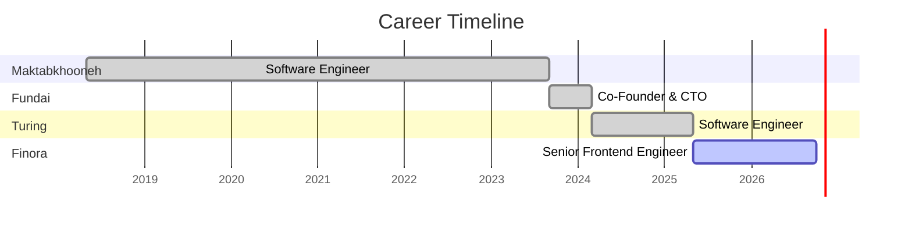

<div align="center">


<br/>

<a href="https://www.farhad-rezaei.com/"></a>
<a href="https://linkedin.com/in/rezaei-farhad"></a>
<a href="mailto:farhadrezaie73@gmail.com"></a>

</div>

<br/>

<h2>


</h2>

<table>
<tr>
<td width="55%" valign="top">

I'm an engineer with **7+ years** of experience building high-performance, data-intensive products across fintech, e-learning and logistics. I work from **first principles** to keep systems stable and fast.

 Building real-time fintech interfaces at **Finora**<br/>
 Specialized in **React, TypeScript and real-time architectures**<br/>
 React apps serving **1M+ users**, real-time UIs at **sub-200ms**<br/>
 Took a startup **from 0 to production** as founding CTO

</td>
<td width="45%" valign="top">

```ts
const farhad = {
  role: "Senior Frontend Engineer",
  based: "Istanbul, TR",
  remote: ["EU", "UAE", "US"],
  frontend: ["React", "Next.js", "TypeScript"],
  state: ["TanStack Query", "Redux Toolkit"],
  realtime: "WebSockets",
  backend: ["Django REST", "Node.js"],
  data: ["PostgreSQL", "Redis"],
  mindset: "first principles",
};
```

</td>
</tr>
</table>

<div align="center">


</div>

<br/>

<h2>


</h2>

<table align="center">
<tr>
<td align="center" width="33%"><b>🎨 Frontend</b><br/><br/></td>
<td align="center" width="33%"><b>⚙️ Backend & Data</b><br/><br/></td>
<td align="center" width="33%"><b>🚀 Infra & Tools</b><br/><br/></td>
</tr>
</table>

<br/>

<h2>


</h2>



<details open>
<summary><b>🟢 Senior Frontend Engineer</b> ·  · <code>May 2025 – Present</code> · UAE · Remote</summary>
<br/>
<ul>
<li>Owned end-to-end delivery of complex fintech features in React and TypeScript, building real-time interfaces displaying <b>100+ live data points</b> per screen.</li>
<li>Built low-latency UI for WebSocket-driven data, sustaining <b>100+ updates/sec</b> at <b>sub-200ms latency</b>.</li>
<li>Designed state architecture with TanStack Query and Redux Toolkit, cutting redundant API calls significantly.</li>
</ul>
<p>    </p>
</details>

<div align="center"></div>

<details open>
<summary><b>🔵 Software Engineer</b> ·  · <code>Mar 2024 – May 2025</code> · USA · Contract</summary>
<br/>
<ul>
<li>Designed prompt and evaluation frameworks that measurably improved LLM output quality on complex React/Next.js/TypeScript tasks.</li>
<li>Evaluated AI-generated frontend code for production readiness using structured validation, Jest, and Playwright.</li>
<li>Led a <b>team of 5 engineers</b> across <b>10+ initiatives</b>, using AI-assisted engineering workflows to speed up delivery.</li>
</ul>
<p>   </p>
</details>

<div align="center"></div>

<details open>
<summary><b>🟣 Co-Founder & Lead Engineer (CTO)</b> ·  · <code>Sep 2023 – Mar 2024</code> · Hybrid</summary>
<br/>
<ul>
<li>Built an AI analytics platform visualizing live market data across <b>700+ companies</b>, optimized for large-scale datasets in React, TypeScript, and Django REST Framework.</li>
<li>Developed ETL pipelines (Scrapy, Pandas, Celery) aggregating data from <b>10+ sources</b> into PostgreSQL.</li>
<li>Optimized queries on <b>30M+ row datasets</b> with indexing and Redis caching, cutting analytics latency from minutes to seconds.</li>
<li>Took the product <b>from 0 to production</b> as founding technical lead of a 3-person team.</li>
</ul>
<p>    </p>
</details>

<div align="center"></div>

<details open>
<summary><b>🔷 Software Engineer</b> ·  · <code>May 2018 – Sep 2023</code> · Hybrid</summary>
<br/>
<ul>
<li>Built user-facing React applications serving <b>1M+ users</b> on a high-traffic product.</li>
<li>Improved page load performance through SSR and caching strategies.</li>
<li>Improved frontend performance using Web Workers and virtualization for large, complex views.</li>
<li>Reduced backend load through optimized data fetching, throttling, and client-side state management.</li>
</ul>
<p>  </p>
</details>

<br/>

<h2>


</h2>

<table>
<tr>
<td width="50%" valign="top">
<h3> Kineforge</h3>
<p>Browser-based <b>SVG animation studio</b> with real-time editing, layered React architecture and optimized rendering pipelines. Supports complex animations, multi-document workflows, and export to production-ready SVG and React components.</p>
<p>  </p>
<a href="https://github.com/rzfarhad73/kineforge"></a>
</td>
<td width="50%" valign="top">
<h3> Django Architect</h3>
<p>CLI tool that generates <b>production-ready Django REST systems</b> with modular architecture, Dockerized infrastructure, CI/CD pipelines and optional integrations (Celery, Kubernetes, S3, Stripe). It standardizes backend architecture and speeds up development.</p>
<p>  </p>
<a href="https://github.com/rzfarhad73/django-architect"></a>
</td>
</tr>
</table>

<br/>

<h2>


</h2>

<div align="center">


</div>

<br/>

<div align="center">
<a href="mailto:farhadrezaie73@gmail.com"></a>
</div>


